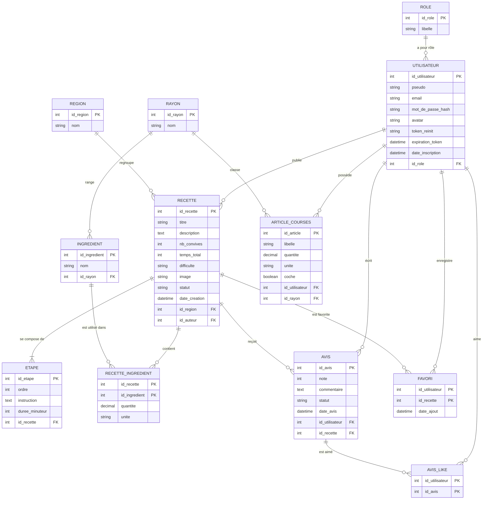

# Schéma de la base de données

## 1. Modèle logique (MLD)



---

## 2. Modèle physique (MPD)

```mermaid
erDiagram
  ROLE ||--o{ UTILISATEUR : "a pour rôle"
  UTILISATEUR ||--o{ RECETTE : "publie"
  REGION ||--o{ RECETTE : "regroupe"
  RECETTE ||--|{ ETAPE : "se compose de"
  RECETTE ||--o{ RECETTE_INGREDIENT : "contient"
  INGREDIENT ||--o{ RECETTE_INGREDIENT : "est utilisé dans"
  RAYON ||--o{ INGREDIENT : "range"
  UTILISATEUR ||--o{ AVIS : "écrit"
  RECETTE ||--o{ AVIS : "reçoit"
  UTILISATEUR ||--o{ FAVORI : "enregistre"
  RECETTE ||--o{ FAVORI : "est favorite"
  UTILISATEUR ||--o{ AVIS_LIKE : "aime"
  AVIS ||--o{ AVIS_LIKE : "est aimé"
  UTILISATEUR ||--o{ ARTICLE_COURSES : "possède"
  RAYON ||--o{ ARTICLE_COURSES : "classe"

  ROLE {
    INT id_role PK "AUTO_INCREMENT"
    VARCHAR(30) libelle UK
  }
  UTILISATEUR {
    INT id_utilisateur PK "AUTO_INCREMENT"
    VARCHAR(50) pseudo UK
    VARCHAR(255) email UK
    VARCHAR(255) mot_de_passe_hash
    VARCHAR(255) avatar "NULL"
    VARCHAR(255) token_reinit "NULL"
    DATETIME expiration_token "NULL"
    DATETIME date_inscription
    INT id_role FK
  }
  REGION {
    INT id_region PK "AUTO_INCREMENT"
    VARCHAR(100) nom UK
  }
  RECETTE {
    INT id_recette PK "AUTO_INCREMENT"
    VARCHAR(150) titre
    TEXT description "NULL"
    INT nb_convives
    INT temps_total "minutes"
    ENUM difficulte "facile, moyen, difficile"
    VARCHAR(255) image "NULL"
    ENUM statut "en_attente, valide"
    DATETIME date_creation
    INT id_region FK
    INT id_auteur FK "NULL"
  }
  ETAPE {
    INT id_etape PK "AUTO_INCREMENT"
    INT ordre
    TEXT instruction
    INT duree_minuteur "secondes, NULL"
    INT id_recette FK
  }
  RAYON {
    INT id_rayon PK "AUTO_INCREMENT"
    VARCHAR(100) nom UK
  }
  INGREDIENT {
    INT id_ingredient PK "AUTO_INCREMENT"
    VARCHAR(100) nom UK
    INT id_rayon FK
  }
  RECETTE_INGREDIENT {
    INT id_recette PK, FK
    INT id_ingredient PK, FK
    DECIMAL(8,2) quantite
    VARCHAR(20) unite "NULL"
  }
  AVIS {
    INT id_avis PK "AUTO_INCREMENT"
    INT note "entre 1 et 5"
    TEXT commentaire "NULL"
    ENUM statut "en_attente, valide"
    DATETIME date_avis
    INT id_utilisateur FK
    INT id_recette FK
  }
  AVIS_LIKE {
    INT id_utilisateur PK, FK
    INT id_avis PK, FK
  }
  FAVORI {
    INT id_utilisateur PK, FK
    INT id_recette PK, FK
    DATETIME date_ajout
  }
  ARTICLE_COURSES {
    INT id_article PK "AUTO_INCREMENT"
    VARCHAR(150) libelle
    DECIMAL(8,2) quantite "NULL"
    VARCHAR(20) unite "NULL"
    BOOLEAN coche
    INT id_utilisateur FK
    INT id_rayon FK
  }
```
